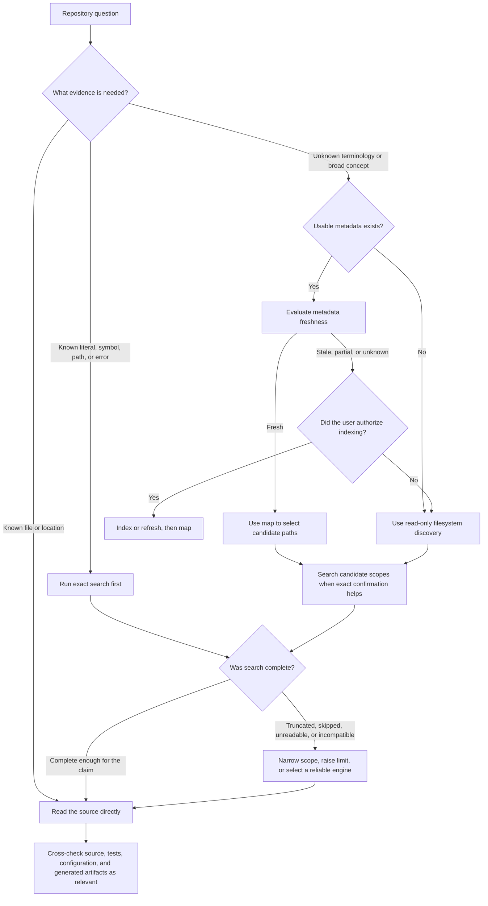

# Agent Retrieval Correctness Plan

## Summary

Make the repository-information workflow safe, complete, and predictable for agents.

The current intended flow is:

1. use `aascribe map` for semantic routing
2. use `aascribe search` for exact confirmation
3. inspect source files before making final claims

That evidence model is sound, but the current skill and command behavior turn it into an overly linear decision tree. The workflow can mutate a repository during a read-only question, treat merely-present metadata as fresh, hide indexed descendants, change search semantics according to whichever executable is installed, and overstate bounded matching-line results as exhaustive occurrences.

This plan keeps the useful separation between routing, exact lookup, and source verification while fixing the safety and correctness gaps in the skill, CLI contract, implementation, and tests.

## Outcomes

After this plan is complete:

- ordinary repository questions remain read-only unless the user explicitly requests indexing or refresh
- an agent chooses `map`, `search`, or direct file inspection according to the question rather than always running all commands
- `ready` means the map node has been checked against the current filesystem, or the output explicitly says freshness is unknown
- partial, stale, corrupt, unreadable, ignored, and truncated results are visible to the caller
- search scope and regex behavior do not silently change across engines
- claims such as "not found" or "every occurrence" require a demonstrably exhaustive search
- large maps and searches remain bounded and navigable
- text and JSON output expose the same decisions in machine-readable form

## Non-Goals

- replacing direct source inspection with summaries
- making `map` proof of presence, absence, or runtime behavior
- silently indexing a repository as a side effect of answering a question
- guaranteeing semantic equivalence between unrelated third-party regex implementations without defining a portable query contract
- turning `aascribe` into a general code-analysis or language-server platform

## Mandatory Test-Driven Execution Protocol

Every problem in this plan must be fixed through its own vertical Red-Green-Refactor cycle. Do not write all tests first and then implement all fixes as a horizontal batch.

For each behavior:

1. **RED — reproduce the problem through a public interface**
   - add one focused integration-style test using the CLI or exported package contract
   - construct a temporary repository or controlled system-boundary fixture that exhibits the problem
   - run the narrowest relevant test command
   - confirm that the new test fails for the intended behavioral reason, not because of malformed setup or an unrelated error
2. **GREEN — make the smallest production change**
   - change only enough code or skill behavior to satisfy the failing scenario
   - rerun the exact same test and confirm that it passes
3. **REGRESSION — prove compatibility**
   - run the owning package test suite
   - run `go test ./...` at the end of each coherent slice or before commit
   - confirm text and JSON behavior together when the public contract has both formats
4. **REFACTOR — only while green**
   - remove duplication or deepen interfaces only after the reproducer passes
   - rerun the focused test and regression suite after refactoring

Required evidence for every completed problem:

- test name and the public behavior it specifies
- RED command and failure summary before production changes
- GREEN command and passing summary after production changes
- regression command and result
- documentation/schema/skill changes required by that behavior

If a proposed test passes before production code changes, it has not reproduced the problem and the cycle must not proceed. Strengthen or correct the test first.

Test design rules:

- assert observable behavior, not private helper calls or internal call order
- prefer invoking `app.Run` or the built CLI with temporary repositories
- do not mock internal `index`, `search`, `map`, or output packages
- use controlled boundary doubles only for external executables, filesystem permissions, time, or other system boundaries
- keep one logical behavior per test; add the next edge case only after the current test is green
- name tests in domain language, such as `TestMapMarksReadyMetadataStaleAfterFileChange`, rather than naming an implementation strategy

## Problem-By-Problem TDD Slices

This is an execution inventory, not a request to create all tests up front. Complete each row as an independent RED → GREEN → regression cycle before starting the next row.

| Order | Problem reproduced in RED | Public behavior required for GREEN |
|---|---|---|
| 1 | A read-only semantic question follows skill instructions that run `init` or `index` | The skill selects read-only discovery unless indexing or refresh was explicitly requested |
| 2 | A known file or exact token still takes the full index → map route | The skill routes known files to direct inspection and exact tokens to search first |
| 3 | A newly added file is absent while its map node still appears trustworthy | Map reports stale/unknown freshness and does not present the node as checked-and-fresh |
| 4 | A modified file keeps an old summary under a trustworthy map node | Map reports stale freshness before the summary can be trusted |
| 5 | A deleted or renamed file remains in map output | Map reports drift and does not present the stale file projection as current |
| 6 | Changed `.gitignore` or `.aaignore` leaves map scope looking fresh | Map reports ignore-policy drift or recomputes the visible scope |
| 7 | An unindexed parent hides a separately indexed descendant | Map marks the subtree uninspected and exposes a deterministic way to inspect candidate descendants |
| 8 | One corrupt metadata file aborts an otherwise useful map | The corrupt node carries a structured issue while healthy siblings remain available |
| 9 | One unreadable metadata file or directory aborts or disappears silently | Map returns a partial result with an `unreadable` node and issue details |
| 10 | A directory symlink indexed by `index` disappears from `map` | Index, eval, and map apply the same documented symlink policy |
| 11 | A symlink cycle or out-of-root target causes recursion or scope escape | Map terminates safely and reports the boundary decision as a structured issue |
| 12 | A `.gitignore` negation is silently treated as unsupported full gitignore behavior | Supported re-inclusion works, or output explicitly identifies the blacklist-only policy |
| 13 | A wide or deep map produces unbounded inline output | Default map output is semantically bounded and every omitted branch has a follow-up command |
| 14 | `--full` cannot recover the complete hierarchy after bounded defaults | `--full` preserves explicit complete traversal subject to reported partial errors |
| 15 | An oversized text map is returned unbounded | It spills to managed output and returns deterministic continuation metadata |
| 16 | An oversized JSON map duplicates the full payload beside transport metadata | Inline JSON is bounded and the complete payload exists only in managed output storage |
| 17 | The same fixed-string query returns different coverage under supported engines | Each supported engine follows the declared scope contract and returns equivalent matching lines |
| 18 | Hidden, ignored, untracked, or `.aaignore` files change inclusion according to installed engine | Result scope metadata describes and enforces one consistent inclusion policy |
| 19 | A regex alternation succeeds with `rg` but returns a false zero result after fallback | Regex meaning is preserved or the command returns an explicit unsupported-query error |
| 20 | A query containing regex metacharacters changes meaning despite `--fixed-strings` | Fixed-string mode is literal and equivalent under every supported engine |
| 21 | An empty query matches every line or triggers uncontrolled output | Empty queries are rejected with the documented invalid-arguments contract |
| 22 | Explicit `--max-count 0` is silently rewritten to 100 | Zero is honored exactly or rejected consistently in parser, runtime, help, and docs |
| 23 | N+1 matching lines are returned without reliable truncation semantics | Exactly N lines are returned and `truncated`/continuation fields are correct |
| 24 | Repeated occurrences on one line are described as multiple exhaustive occurrences without being represented | The contract reports matching lines, or an explicit occurrence mode returns every submatch |
| 25 | Passing a file path silently searches its parent directory | Exact-file scope searches only that file, or the CLI rejects file scope explicitly |
| 26 | An unreadable search path is skipped but the result says complete | Result sets `complete: false` and includes a structured partial reason |
| 27 | A line beyond the scanner token limit is silently missed | The match is found within the supported bound or a scanner-limit issue makes the result incomplete |
| 28 | A binary file exclusion is indistinguishable from an I/O failure | Scope/result metadata distinguishes deliberate binary exclusion from read failure |
| 29 | A filename containing colons corrupts parsed path, line, or column fields | Structured parsing returns the exact filename and location |
| 30 | Unicode text produces undocumented or inconsistent columns across engines | The contract defines byte or character columns and supported engines agree |
| 31 | External search output is fully buffered before `--max-count` is applied | Search streams or applies an engine-side bound and remains memory-bounded |
| 32 | External executable detection succeeds but execution fails, preventing a safe fallback or clear diagnosis | Failure is classified according to the engine contract and cannot become a false zero result |
| 33 | Truncated or incomplete search output still supports an absence claim in skill guidance | Skill requires adequate scope, `complete: true`, and `truncated: false` before absence claims |
| 34 | Skill prose, help, schemas, and bundled binary disagree after the CLI changes | A contract audit test detects drift and the rebuilt bundle matches the documented behavior |

## Correct Agent Decision Tree

The skill must route by intent before selecting a command.



Decision rules:

- Do not run `init`, `index`, `index dirty`, `index clean`, or `index --refresh` for a read-only question unless the user requested that mutation.
- If the exact file is already known, read it before consulting the map.
- If the exact token is known, search first; a semantic map is optional.
- Use `map` when terminology is uncertain or a broad concept needs routing.
- Treat summaries as hypotheses and source files as evidence.
- Do not make an absence claim when output is truncated, freshness is unknown, traversal skipped data, or engine coverage is narrower than the claimed scope.

## Contract Changes

### 1. Separate read-only discovery from indexing

Revise `skills/indexing-folder/SKILL.md` so its default path is read-only:

1. locate the bundled binary
2. inspect whether metadata already exists
3. choose direct read, search, or map according to intent
4. run `index eval` only when metadata exists and map freshness matters
5. request or infer indexing authority only from an explicit indexing/refresh request

`init` and `index` move into a separate, explicitly mutating workflow.

The skill must state the artifacts each mutating command writes and must not suggest exporting a real secret in prose examples. Refer callers to configured secret handling instead of showing `export GEMINI_API_KEY="your-real-key"`.

### 2. Define map freshness precisely

Replace the ambiguous meaning of `ready` with explicit freshness information.

Recommended node fields:

```json
{
  "state": "ready",
  "freshness": "fresh",
  "freshness_checked": true,
  "partial": false,
  "issues": []
}
```

Supported values:

- `state`: `ready`, `dirty`, `unindexed`, `corrupt`, `unreadable`
- `freshness`: `fresh`, `stale`, `unknown`
- `partial`: true when descendants or file details were omitted or could not be inspected

Compatibility rule:

- retain the existing `state` field
- add freshness and issue fields additively
- do not silently redefine old `ready` payloads as freshness guarantees until consumers and docs have migrated

Map freshness must detect at least:

- newly added direct files
- deleted or renamed direct files
- changed direct-file content or metadata fingerprints
- dirty metadata
- missing child metadata
- changes to ignore configuration that affect visible scope

The implementation may reuse `index eval` internals, but it should expose one coherent map result rather than requiring agents to merge unrelated outputs themselves.

### 3. Make map traversal resilient

Map assembly must preserve as much useful routing information as possible.

- An unindexed node must say that its subtree was not inspected, or optionally expose child directory stubs without claiming they are indexed.
- A corrupt metadata file becomes a `corrupt` node with a structured issue instead of aborting the entire map.
- A permission or read failure becomes an `unreadable` node and marks the containing map partial.
- Directory symlinks must follow the same documented policy in `index`, `index eval`, and `map`.
- Symlink cycles and paths escaping the requested root must be detected; the chosen policy must be explicit and tested.
- `.gitignore` and `.aaignore` semantics must be stated accurately. Either implement supported negation/re-inclusion behavior or document and surface the blacklist-only subset.
- New or removed files must not remain invisibly inconsistent with a `ready` node.

### 4. Bound map output through semantic expansion

Add progressive map controls:

```text
aascribe map <path> [--depth <n>] [--summary-only] [--max-files-per-dir <n>] [--full]
```

Recommended defaults:

- bounded depth suitable for agent routing
- capped direct-file entries per directory
- summaries and node state retained in bounded output
- omitted branches include their path and an exact follow-up command

Example continuation:

```json
{
  "partial": true,
  "omitted": {
    "reason": "depth_limit",
    "next": "aascribe map ./internal/index --depth 2"
  }
}
```

`--full` preserves the current complete hierarchy behavior for callers that explicitly need it. Managed `output_id` spilling remains a final safety net for oversized text and JSON payloads; it is not the primary navigation model.

### 5. Define one search scope contract

Before preserving multiple engines, define what a search is supposed to cover.

The result must disclose at least:

```json
{
  "engine": "rg",
  "query_mode": "fixed",
  "scope": {
    "root": "/abs/path",
    "tracked_only": false,
    "hidden": false,
    "ignored": false,
    "ignore_sources": [".gitignore", ".aaignore"]
  },
  "complete": true,
  "partial_reasons": []
}
```

Decisions required before implementation:

- whether default search follows map ignore policy or searches all readable files
- whether hidden, ignored, untracked, generated, and metadata files belong to the default scope
- whether a file path searches exactly that file or is rejected; it must never silently broaden to the parent directory
- how unreadable files and directories affect `complete`

Recommended direction:

- default to the same ignore policy as `map`
- add explicit flags for broader coverage, such as `--hidden`, `--no-ignore`, or a single clearly named exhaustive-scope option
- accept both a directory and an individual file as exact scopes

### 6. Stabilize fixed-string and regex behavior

Fixed-string mode should be the portable default for confirmation workflows.

- `--fixed-strings` must have equivalent query semantics across all engines.
- Empty queries must be rejected unless an explicit engine-probe command is introduced.
- Regex mode must use one documented dialect or restrict fallback to engines that can preserve the selected dialect.
- Do not accept a successful zero-result response from an engine whose regex semantics differ from the requested contract.
- Replace the skill's portable-looking alternation example with repeated fixed-string searches, or require a named regex dialect/engine.

Preferred implementation options, in order:

1. use `rg` when available and use the builtin matcher as the correctness fallback
2. use `git grep` or `grep` only for fixed-string mode where equivalent flags and scope can be guaranteed
3. otherwise return an explicit unsupported-engine/unsupported-query error rather than silently changing meaning

### 7. Correct search result semantics

Change the public wording from "every occurrence" to the exact implemented unit.

Recommended v1 unit:

- one result per matching line
- `returned_match_lines`: number included in the response
- `total_match_lines`: exact total when known, otherwise omitted
- `truncated`: whether additional matching lines exist
- `complete`: whether all files in the declared scope were searched successfully

If per-occurrence output is needed later, add an explicit mode with start/end columns for every submatch.

Fix limit behavior:

- distinguish an unspecified limit from explicit `--max-count 0`
- either honor zero exactly or reject it; docs and implementation must agree
- pass safe limits to external processes or stream their stdout rather than buffering complete output with `cmd.Output()`
- stop work promptly after enough evidence exists while still setting truncation accurately
- keep `match_count` compatibility during migration, but document whether it means returned lines or total lines

### 8. Surface partial search failures

Search must never silently convert skipped content into a complete zero-result answer.

- collect unreadable file/directory issues
- report long-line scanner failures
- increase scanner buffers where bounded long lines are supported
- distinguish binary-file exclusion from I/O failure
- handle filenames containing separators used by line-oriented parsers
- prefer structured output protocols such as `rg --json`; avoid colon parsing where filenames can make it ambiguous
- define whether multiple matches on one line produce one matching-line result or multiple occurrence results

### 9. Connect search and map to large-output transport

Both commands need bounded production, not only bounded final rendering.

- stream or cap external search output before loading it into memory
- make map projection honor semantic depth/file limits before serialization
- spill oversized final text and JSON payloads through the existing managed output store
- ensure JSON spilling does not retain the full unbounded value beside the transport metadata
- return deterministic `output show` and `output slice` continuation hints
- test retention and missing-output behavior without weakening the command's `partial`/`complete` semantics

## Implementation Phases

Phases describe sequencing and ownership boundaries. Within every phase, execute the numbered TDD slices above one at a time. A phase is not permission to batch all of its tests before implementation.

### Phase 1: Lock the contract and fix the skill

Deliverables:

- execute TDD slices 1, 2, and 33 individually
- update `docs/USAGE.md` with precise routing, freshness, scope, completeness, and match-unit language
- update `skills/indexing-folder/SKILL.md` to use the intent-based read-only decision tree
- separate mutating index setup from ordinary information gathering
- remove or correct claims about every occurrence and engine-equivalent fallback
- document current limitations until later phases land

Acceptance criteria:

- each completed slice has captured RED, GREEN, and regression evidence
- a read-only repository question does not instruct the agent to create a store or metadata
- known-file, exact-term, and semantic-routing questions take different documented branches
- absence claims require `complete: true`, `truncated: false`, and an adequate declared scope

### Phase 2: Search correctness foundation

Deliverables:

- execute TDD slices 17 through 32 individually, in an order that keeps the public contract coherent
- introduce internal search result completeness and scope models
- fix explicit zero-limit behavior and reject empty queries
- stop silently broadening file paths
- make fixed-string fallback equivalent
- choose and enforce regex-dialect behavior
- stream or limit external engine output
- report unreadable paths, scanner errors, binary exclusions, and parsing limitations

Acceptance criteria:

- each search problem was reproduced by a failing public-interface test before its production fix
- the same fixed-string fixture returns the same matching lines and scope metadata under every supported engine
- regex requests never silently change meaning during fallback
- explicit zero, default limit, exact limit, and limit-plus-one cases have deterministic results
- a skipped unreadable file yields `complete: false`
- an exact file path searches only that file

### Phase 3: Map freshness and resilient traversal

Deliverables:

- execute TDD slices 3 through 12 individually
- add freshness, partial, and structured issue fields to `PathIndexMap`
- detect direct-file and ignore-policy drift
- represent corrupt and unreadable nodes without aborting unaffected branches
- align symlink policy across index, eval, and map
- expose uninspected descendants explicitly

Acceptance criteria:

- each map correctness problem was reproduced by a failing public-interface test before its production fix
- added, modified, renamed, and deleted files cannot leave a node presented as checked-and-fresh
- corrupt metadata in one child preserves usable sibling routing
- unindexed parents do not imply that indexed descendants are absent
- symlink directory behavior is identical across index, eval, and map, including cycle protection

### Phase 4: Progressive map and output transport

Deliverables:

- execute TDD slices 13 through 16 individually
- implement depth, summary-only, direct-file cap, and full-output controls
- add structured branch continuation hints
- connect bounded map/search payloads to managed output storage
- preserve text/JSON parity

Acceptance criteria:

- each output-bounding problem was reproduced by a failing public-interface test before its production fix
- default map output is bounded for wide and deep fixture trees
- every omitted branch has a deterministic follow-up command
- `--full` preserves complete traversal subject to explicit partial errors
- oversized JSON does not duplicate the full payload inline

### Phase 5: Agent workflow integration and regression audit

Deliverables:

- execute TDD slice 34 before rebuilding or publishing the bundle
- rebuild the bundled skill binary after command changes
- run the skill against representative indexed, stale, unindexed, ignored, symlinked, and partially unreadable repositories
- audit all documentation and examples for old linear-flow or exhaustive-search claims
- publish a compatibility/migration note for agents consuming `PathIndexMap` and `SearchResult`

Acceptance criteria:

- the contract audit test failed against the stale bundle before the bundle was rebuilt, then passed afterward
- the bundled binary matches the documented source revision
- the skill selects the intended branch in each workflow fixture
- no source-scoped search finds stale claims about `ready`, every occurrence, or equivalent engine fallback

## TDD Scenario Inventory

The scenarios below refine the numbered slices. They must be pulled into the active slice only when that slice begins; do not implement this section as a separate test-writing phase.

### Skill and contract tests

- read-only semantic question with no metadata
- exact literal question with no metadata
- known source path
- existing fresh metadata
- stale metadata without indexing authorization
- explicit user request to index or refresh
- truncated and incomplete search before an absence claim

### Map tests

- new direct file after indexing
- modified direct file after indexing
- deleted and renamed direct file after indexing
- changed `.gitignore` or `.aaignore`
- root unindexed with an indexed descendant
- corrupt child metadata with healthy siblings
- unreadable child directory or metadata file
- symlink to directory, broken symlink, cycle, and out-of-root target
- ignored directory and supported negation behavior
- very wide directory
- deeply nested tree
- text and JSON continuation parity
- oversized output spill and retrieval

### Search engine contract tests

Run shared fixtures against every supported engine:

- fixed string with regex metacharacters
- case-sensitive and case-insensitive fixed strings
- portable regex and unsupported regex
- empty query
- exact zero, one, N, and N+1 limits
- repeated matches on one line
- Unicode content and column semantics
- line longer than the default scanner token
- binary file
- unreadable file and directory
- filename containing colons
- hidden, ignored, untracked, and tracked files
- `.aaignore` behavior
- directory scope and exact-file scope
- non-Git directory
- subprocess failure after engine detection

### Integration tests

- `map -> search -> source read` on a fresh index
- stale map routes to freshness handling before claims
- an unavailable `rg` does not change fixed-string results
- an unavailable regex-compatible engine produces an explicit error rather than a false zero result
- large search output remains memory-bounded and returns usable continuation metadata
- JSON envelopes remain valid and logs remain on stderr

## Documentation Updates

Files expected to change during execution:

- `docs/USAGE.md`
- `docs/reference/aascribe_ai_output_shapes.md`
- relevant schemas under `docs/shapes/`
- `skills/indexing-folder/SKILL.md`
- installation/bundled-binary instructions if flags or binary layout change

Documentation must clearly distinguish:

- routing evidence from source evidence
- metadata presence from verified freshness
- returned matching lines from total occurrences
- truncated output from incomplete filesystem coverage
- read-only discovery from repository mutation

## Compatibility And Migration

- Prefer additive JSON fields during the first release.
- Preserve `state`, `match_count`, `truncated`, and current command names while adding precise fields.
- Introduce bounded `map` defaults only with `--full` as an escape hatch and a migration note.
- Keep `index map <path>` as an alias unless separately deprecated.
- Rebuild and version the bundled skill binary with the contract change so skill prose and executable behavior cannot drift.

## Risks

- Running freshness checks during every map can become expensive. Mitigate with cheap fingerprints, bounded stat work, and explicit `freshness: unknown` when verification is intentionally skipped.
- Strict engine parity may reduce fallback choices. Correct explicit failure is preferable to a false zero-result answer.
- Following symlinks can escape scope or create cycles. Resolve paths, track visited identities, and make the boundary policy explicit.
- Default bounded maps change output volume. Preserve complete behavior through `--full` and structured continuation commands.
- Matching `.gitignore` exactly is complex. Reuse a mature matcher or document a deliberately smaller `.aaignore` contract rather than approximating silently.

## Definition Of Done

This work is complete when:

- every numbered problem has a recorded public-interface RED test that failed for the intended reason before its production fix
- every RED reproducer passes against the modified code, and all regression suites are green
- no phase was implemented as a horizontal "all tests, then all code" batch
- the skill's decision tree is read-only by default and intent-aware
- map freshness and partial states cannot create false confidence
- supported search engines share one enforced fixed-string and scope contract
- regex fallback cannot silently change query meaning
- zero results carry enough structured evidence to judge whether absence is supportable
- map and search remain bounded for large repositories
- all listed edge cases have automated coverage
- CLI docs, schemas, help text, skill instructions, bundled binary, and implementation agree
- `go test ./...`, relevant end-to-end fixtures, and source-scoped documentation audits pass
